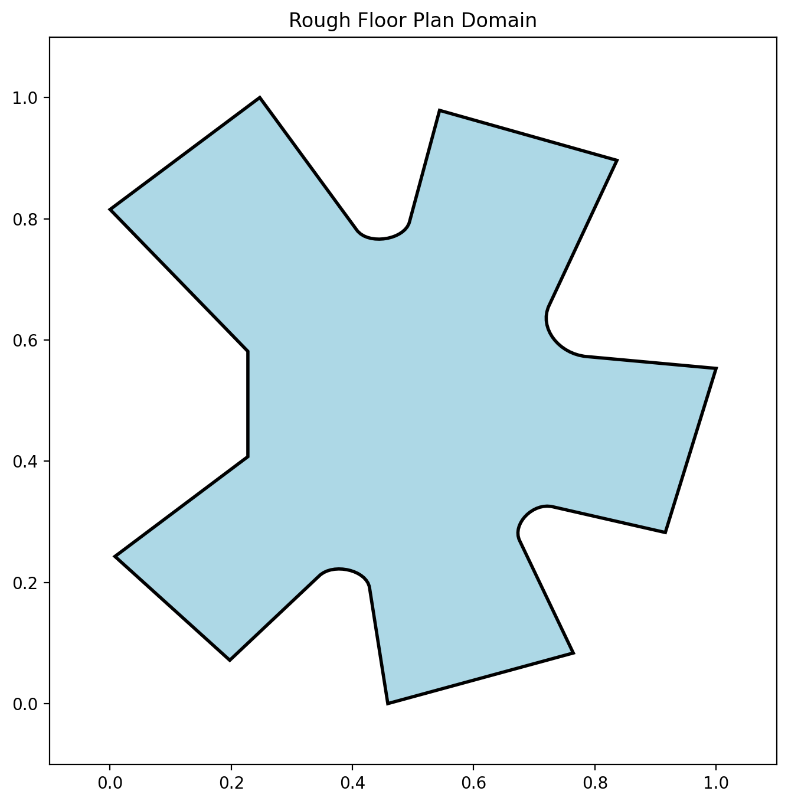
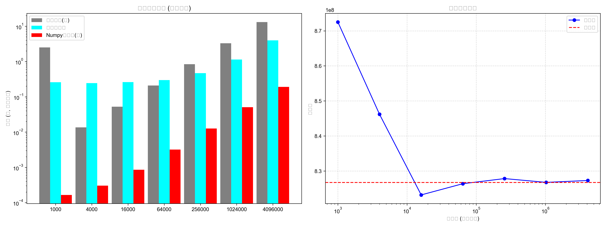

# Breaking the Compute Bottleneck: Monte Carlo Area Estimation of Irregular Buildings, Accelerated by Vectorization and Multiprocessing

**突破算力瓶颈：基于向量化与多进程并行的不规则建筑面积模拟优化研究**

> 🏆 **Second Prize (Junior High Division), 37th Jiangsu Provincial Youth Science & Technology Innovation Competition, June 2026**
> 第三十七届江苏省青少年科技创新大赛 青少年科技创新成果 初中组二等奖（证书编号 JSCA20264050221453）



## Overview

How do you measure the area of a building whose outline is curves, not rectangles?
This project estimates the area of an irregular floor plan with **Monte Carlo simulation** — and, more importantly, asks what happens when the simulation itself becomes too slow. Starting from the classic "estimate π by throwing random points" experiment, a plain Python loop hits a wall at ~10 million samples. The project then benchmarks three implementations and shows that **NumPy vectorization runs ~100× faster than the serial loop** at million-sample scale, with estimation error following the theoretical 1/√N convergence law.

## What it does

1. **Models the building.** 29 feature points are extracted by hand from a floor-plan drawing; straight segments and four cubic Bézier curves (`matplotlib.path.Path` with `CURVE4` codes) form the closed domain in `fp.py`. Coordinates are normalized to the unit square, and point-in-domain tests use `Path.contains_points`.
2. **Benchmarks three engines** (`MonteCarlo_Pi_Research.py`):
   - `mc_slow` — serial `for` loop (baseline);
   - `mc_numpy` — fully vectorized sampling and counting;
   - `mc_multiprocess` — `multiprocessing.Pool` with `starmap`, work split across processes.
3. **Runs two experiments** across 7 sample sizes (1,000 → 4,096,000, ×4 steps): estimating π (ground truth known exactly) and estimating the building's area (validated against the analytic path area), recording runtime and accuracy for each engine.

## Key results



- At ~1M samples: vectorized ≈ **0.04 s** vs serial loop ≈ **6–20 s** (≈100× speedup; exact figures in the paper).
- Estimation error shrinks with sample size following **1/√N**, as theory predicts.
- Multiprocessing helps the loop version but cannot beat vectorization — process startup and IPC overhead dominate at this scale.

Full data tables, charts and the debugging log (a dimension-alignment bug `(2,N)` vs `(N,2)`, and a multiprocessing argument-passing fix) are in the [research paper](paper/research_paper.pdf).

## Run it

```bash
pip install -r requirements.txt
python MonteCarlo_Pi_Research.py   # building-area experiment; switch the commented line in __main__ for the π experiment
python fp.py                        # preview the floor-plan domain
```

Requires Python 3.12+, NumPy, Matplotlib, tqdm. Note: the serial loop is intentionally slow at large N — that is the point of the benchmark.

## Repository layout

```
MonteCarlo_Pi_Research.py   # benchmark harness: 3 engines x 2 experiments + plotting
fp.py                       # floor-plan domain: 29 vertices, Bezier curves, normalization
results/                    # output charts (efficiency comparison + convergence)
paper/                      # full research paper (PDF / DOCX, in Chinese)
docs/                       # author's original working notes
```

## Roadmap

- Automatic boundary extraction from drawings with OpenCV (replacing hand-picked points);
- A ground-truth field test: apply the estimator to Nantong old-town greening areas and compare against surveyed values.

## Author

**Miao Miao （缪妙）** — Nantong Qixiu Middle School, Jiangsu, China. Faculty adviser: Zhang Yu （张育）.
Research period: March–June 2026.

---

## 中文简介

本项目用蒙特卡罗方法估算不规则建筑平面图的面积，并系统研究了模拟本身的算力瓶颈：纯 Python 循环在千万级采样时不可用。项目从建筑图纸人工提取 29 个特征点，以直线段和三次贝塞尔曲线建模轮廓，对串行循环、NumPy 向量化、多进程并行三种实现做了 7 档采样量（1 千至 409.6 万）的对照实验：向量化在百万级采样约 0.04 秒，较串行循环加速约 100 倍；误差服从 1/√N 收敛规律，并与解析真值完成对照校验。完整论文、数据表与调试记录见 `paper/` 目录。

## License

MIT — see the repository's license note. Code and paper © Miao Miao.
